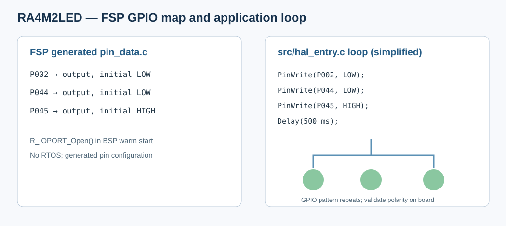

# 01 - RA4M2 LED Demo 评估报告

## 1. 工程定位

路径：`..\RA4M2LED`。这是 R7FA4M2AD / Cortex-M33 的最小 FSP GPIO 输出示例，用于验证板载 LED 引脚映射、IOPORT 初始化和工具链基本链路。它不包含 Wi-Fi、AT 协议、显示或产品状态机。

## 2. 硬件与 FSP 配置



生成配置 `ra_gen/pin_data.c` 把 LED 引脚设为输出；主循环依次组合不同电平，每 500 ms 延时：

```c
R_IOPORT_PinWrite(&g_ioport_ctrl, BSP_IO_PORT_00_PIN_02, BSP_IO_LEVEL_LOW);
R_IOPORT_PinWrite(&g_ioport_ctrl, BSP_IO_PORT_04_PIN_04, BSP_IO_LEVEL_LOW);
R_IOPORT_PinWrite(&g_ioport_ctrl, BSP_IO_PORT_04_PIN_05, BSP_IO_LEVEL_HIGH);
R_BSP_SoftwareDelay(500, BSP_DELAY_UNITS_MILLISECONDS);
```

对应位置：`src/hal_entry.c` LED pattern；`ra_gen/pin_data.c` 输出方向和初始电平；`configuration.xml` 的 P002/P044/P045 输出配置。

| LED | RA4M2 引脚 | 生成配置 | Demo 行为 |
|---|---|---|---|
| LED3 | P002 | GPIO output low | Pattern 中轮流拉高/拉低 |
| LED2 | P044 | GPIO output low | Pattern 中轮流拉高/拉低 |
| LED1 | P045 | GPIO output high | Pattern 中轮流拉高/拉低 |

具体亮灭极性应以板卡原理图/丝印和实测为准；天气工程已按该板卡约定“GPIO 高电平点亮”实现联网/天气状态指示。

## 3. 软件与 FSP

- `configuration.xml` 声明 RA4M2 custom board、IOPORT、启动时钟和 pin configuration；此 demo 配置及实际 headers 是 FSP **3.2.0**，不要与其他 6.6 工程混为一谈。
- `ra_gen/hal_data.c` 只初始化 common HAL；`R_BSP_WarmStart()` 在 POST_C 调用 `R_IOPORT_Open()`。
- 工程内携带生成的 FSP 6.6.0 源码；未启用 RTOS。源码主体就是三组 `R_IOPORT_PinWrite()` 和延时，适合外设冒烟测试，不适合作产品 LED driver 原样复用（产品需由应用状态驱动，避免固定阻塞 delay）。

## 4. GCC / FSP 构建评估

`configuration.xml` 与实际 headers 均为 FSP **3.2.0**，ToolchainVersion **GCC 9.3.1 / 9_2020q2**；`Debug/makefile.init` 记录的是 `e2studio_v2021-07_fsp_v3.2.0`，与现安装的 `%FSP_ROOT%` 不同。clean build 在当前 GCC 13.2.1 兼容通过，不应据此把旧项目元数据/生成包称为 FSP 6.6。

当前环境对 `Debug` 执行 `make -B -j8 all` 已验证链接成功，产生 `RA4M2LED.elf`（约 3.8e5 bytes，包含符号表的 ELF 文件大小；链接 size 约 text 3 KB）。生成的 `.mk` 规则使用 `-mcpu=cortex-m33 -mthumb -mfloat-abi=hard -mfpu=fpv5-sp-d16`。

**升级注意事项**：FSP pack、RA 配置器、CDT make generator 和 GCC 是四个相关但独立的版本。不要只更新 `ra/` SDK 或 `configuration.xml` 版本标签。升级后应重新生成并审核 `ra_gen/`、`ra_cfg/`、vector、BSP 头文件和所有 `subdir.mk`，再 Clean 全量编译。残留旧 `.o` 会造成 Cortex 架构/Hard-Float ABI 冲突。

## 5. 结论

适合作 RA4M2 GPIO 输出、IOPORT 初始化和电气连通性基线。LED 电平语义、软件延时占用和实际板测仍应在集成工程中单独验收。本次报告的 clean build 通过；不代表四个 LED 接线在所有开发板版本上都已实测。
