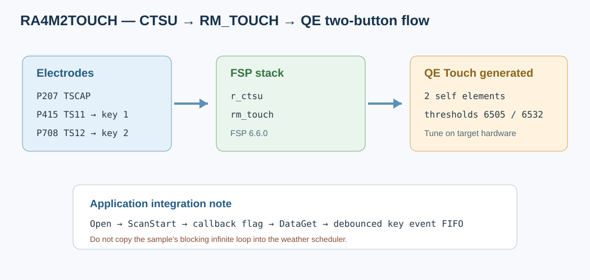

# 02 - RA4M2 Touch Demo 评估报告

## 1. 工程定位

路径：`..\RA4M2TOUCH`。该工程使用 RA4M2 CTSU 自容扫描和 FSP RM_TOUCH middleware，结合 QE Touch 生成文件实现两个触摸按键。它是 weather_app 触摸层的主要参考，不是完整按键产品逻辑。

## 2. 引脚和配置



| 信号 | RA4M2 引脚 | FSP 角色 |
|---|---|---|
| TSCAP | P207 | CTSU 公共电容端 |
| TS11 | P415 | CTSU self-cap element 0 |
| TS12 | P708 | CTSU self-cap element 1 |

`configuration.xml` 中启用 `ctsu0.mode.enabled`、`ctsu0.ts11.p415`、`ctsu0.ts12.p708` 和 `ctsu0.tscap.p207`；stack 中含 `touch_on_touch` 与其依赖的 `ctsu_on_ctsu`。QE 生成文件 `qe_gen/qe_touch_config.c` 定义两组 element 配置、两个阈值和 `g_qe_touch_instance_config01`。`qe_touch_sample.c` 展示典型轮询步骤：

```c
RM_TOUCH_Open(g_qe_touch_instance_config01.p_ctrl,
              g_qe_touch_instance_config01.p_cfg);
RM_TOUCH_ScanStart(g_qe_touch_instance_config01.p_ctrl);
while (0 == g_qe_touch_flag) { }
g_qe_touch_flag = 0;
RM_TOUCH_DataGet(g_qe_touch_instance_config01.p_ctrl,
                 &button_status, NULL, NULL);
```

QE 定义使用 2 个 self elements、2 个 buttons，TSCAP 端口 `0x0207`，VCC 3300 mV，PCLK division 1。阈值是板卡、电极、overlay、接地和环境相关的标定参数，必须在目标板上做 baseline/noise/湿手/邻键干扰测试，不能把 demo 阈值当成通用值。

## 3. Demo 行为与集成风险

- `src/hal_entry.c` 直接进入 `qe_touch_main()`；它在内部无限扫描循环，扫描等待是忙等，无法直接并入产品的协作式 AT/weather 主循环。
- weather_app 改用 `key_scan.c` 周期性 `RM_TOUCH_ScanStart/DataGet`，把触摸状态转为按键事件，不调用 demo 的无限循环。
- Touch demo `hal_entry.c` 对 `qe_touch_main()` 有 implicit declaration warning（头文件未声明该 sample 函数），当前能链接是因为 sample 源定义已纳入；建议以正式公共声明收敛，不影响本报告所记录的构建结论。
- 必须把 `qe_gen/qe_touch_config.c` 加入 source entries/makefile。若遗漏，会在链接时出现 `g_qe_touch_flag`、`g_qe_touch_instance_config01` undefined reference。
- `QE_TOUCH_CONFIGURATION` 对 `r_ctsu_cfg.h`/`rm_touch_cfg.h` 条件宏有覆盖/重定义影响。RASC 重生成可能改写 CTSU element count、VCC、PCLK 和 TSCAP 配置；生成后需对照 QE define 与 pin_data，不应把差异当作无害格式变化。

## 4. GCC / FSP 版本与构建

工程配置头部记录 FSP **6.6.0**，实际 `ra/fsp/inc/fsp_version.h` 也为 6.6.0。`configuration.xml` ToolchainVersion 仍标为 GCC **10.3.1.20210824**，但当前 `Debug/makefile.init` 实际指向本机 e² studio GCC **13.2.1**；生成元数据落后，应以 makefile.init 和实际编译命令作为当前构建依据。

使用当前 Windows 工具链运行 `make -B -j8 all` 已通过，产物 `RA4M2TOUCH.elf` 链接 size 约 text 8.5 KB / data 8 B / bss 1.7 KB。warning 包括 QE sample 的缺失原型。若换到 Linux/MSYS shell 直接运行旧 makefile，环境 PATH 可能找不到 `arm-none-eabi-gcc`；这属于 host build environment，不是 C 源码错误。

## 5. 结论 / 对 weather_app 的建议

该工程验证 CTSU/RM_TOUCH/QE Touch 集成的构成和 pin assignment。weather_app 已吸收其 FSP stacks、QE 生成文件和 source build rules；但长按配网等事件行为仍需结合产品主循环和板上阈值实测验收。
