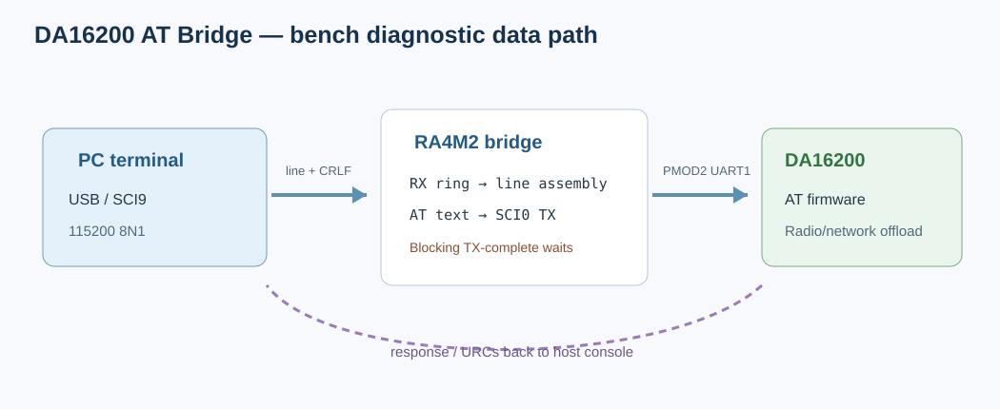

# 03 - DA16200 AT Bridge 评估报告

## 1. 工程定位

路径：`..\da16200_at_bridge`。此工程是 RA4M2 与 DA16200 AT firmware 之间的 UART 透传/串口诊断桥，用于验证 PMOD/SCI 连线和手动 AT 命令。DA16200 内运行既有 AT firmware；本工程不修改或重新构建 DA16200 SDK firmware。

## 2. 硬件连接与 FSP UART



| 用途 | RA4M2 资源 | 作用 |
|---|---|---|
| PC/USB 控制台 | `g_usb_uart`, SCI9, 115200 8N1 | 串口助手输入命令/输出回显 |
| DA16200 AT 口 | `g_wifi_uart`, SCI0, 115200 8N1 | 发 AT 命令，接收 AT/URC |
| PMOD2 | P410/P411 | SCI0 RX/TX 到 DA16200 UART1，交叉接收/发送 |

`configuration.xml` 选择 FSP 6.6.0，定义 SCI9 与 SCI0 两个 UART instance 和 callback。`ra_gen/hal_data.c`、`pin_data.c` 由 RASC 生成。构建参数应保持 Cortex-M33、Thumb、hard-float 和 FPU 选项一致。

## 3. 数据路径和示例代码

接收中断只把字节写 ring buffer；主循环组行。桥对 AT 命令补 CRLF 后写入 WIFI SCI；模块回包以 `[WIFI]` 前缀输出。

```c
static void wifi_line_send(const char *buf, uint16_t len)
{
    /* 复制到 TX buffer；缺少 CR/LF 时追加 CRLF */
    err = R_SCI_UART_Write(&g_wifi_uart_ctrl, (uint8_t *)tx_buf, tx_len);
    if (FSP_SUCCESS == err) {
        while (!wifi_uart_send_complete_flag) { }
        wifi_uart_send_complete_flag = false;
    }
}
```

来源：`src/hal_entry.c` 的 `wifi_uart_cb()`、`wifi_line_send()`、`rx_line_flush()`。代码适合作 bench bring-up 和串口调试，但存在阻塞点：printf 每字符等待 TX complete；WIFI 发送也等待 TX complete。若用于连续大数据、HTTP response 或实时状态机，容易阻塞主循环、增加 RX overflow 风险。

## 4. 对天气工程的演进意义

天气工程从桥工程继承 SCI0/SCI9 和 ring-buffer/UART callback 思路，再加入异步 `at_engine`、URC FIFO、payload 模式、HTTP 解析、定时联网和 SoftAP TCP server。实际页面配网使用 DA16200 AT firmware 的 SoftAP/DHCP/TCP Server；RA4M2 自己承载 HTTP parser/UI。普通配网不使用 `AT+PROVSTART`，也不要求改 DA16200 firmware。

桥工程和天气工程是两种用途：前者人工实验、代码极简；后者产品状态机。不要把桥中阻塞 `while(TX_COMPLETE)` 方式复制回天气主循环。

## 5. 版本与构建问题

该工程 configuration/FSP 文件是 FSP 6.6 系列，但 `configuration.xml` ToolchainVersion 仍为 GCC **10.3.1**；`Debug/makefile.init` 指向另一台开发机的工作目录 / Renesas 安装目录。当前工作区有旧 ELF 产物，但本次在本机执行 clean build 时，即使提供 GCC 13.2.1 PATH，生成规则仍用失效的绝对 include paths，导致 `hal_data.h` / `bsp_api.h` 找不到，无法从本机工作区复现 clean build。需在原开发机路径构建，或刷新 CDT 项目生成规则/移除绝对路径后再验。不能将已有 ELF 当作当前源码已可复现构建的证明。对这个纯桥项目，仅更新 FSP 文件而保留旧 vector/make rules 也可能造成对象/符号缺失。

该 workspace 现有 ELF 产物可参考，但报告的 clean build 状态以实际运行日志/本次评估命令为准；请勿把 ELF/HEX 当作 source 或长期验证证据入 Git。

## 6. 结论

该桥是 DA16200 AT firmware 的低风险硬件 bring-up 手段。实际产品功能在 RA4M2 完成；DA16200 负责 Wi-Fi、DHCP、TCP socket 和 AT networking offload。推荐保留桥工程作为独立诊断工具，不把其阻塞式数据路径作为天气工程网络层。
