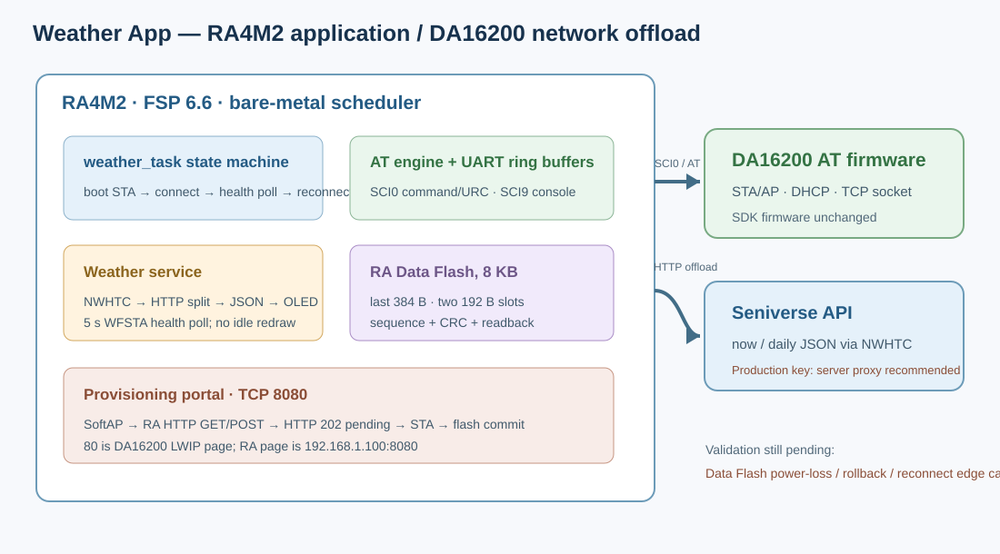

# 04 - RA4M2 + DA16200 Weather App 集成评估报告

## 1. 工程定位与分工



路径：`.`。这是四个项目中唯一的系统集成 demo，负责天气业务和网页配置：

```text
RA4M2 (Cortex-M33, FSP 6.6, bare-metal)
  ├─ SCI9 / USB UART：console + diagnostics
  ├─ SCI0：DA16200 AT command / URC / raw TCP frames
  ├─ AT engine → Wi-Fi link state → NWHTC HTTP → JSON parser
  ├─ SoftAP request → DA TCP server → RA HTTP form/parser
  ├─ Data Flash: SSID/password/city dual-slot settings
  └─ OLED/UI + mechanical keys + QE Touch integration
DA16200 AT firmware: radio, AP/STA association, DHCP, TCP sockets, HTTP request transport
```

DA16200 没有在这个工程中运行天气应用程序，也没有修改其 SDK firmware。RA4M2 负责业务、HTTP 表单、JSON/天气 UI、配置策略和 RA Data Flash 设置副本。

## 2. 关键配置与引脚

| RA4M2 资源 | 用途 | 工程配置 |
|---|---|---|
| P410/P411, SCI0 | DA16200 AT UART | `g_wifi_uart`, 115200，weather_task/at_engine |
| P109/P110, SCI9 | USB console | `g_usb_uart`, 115200，异步 TX pump |
| P207/P415/P708 | TSCAP/TS11/TS12 | CTSU + RM_TOUCH + QE Touch |
| P005/P006 | 机械按键 | refresh/page/provision events |
| P045/P044/P002 | LEDs | Wi-Fi/weather/activity indication |
| Data Flash `0x08000000..0x08001FFF` | 8 KB | 最后 384 B 作为两个 192 B 设置槽 |

`configuration.xml` 选择 RA4M2 R7FA4M2AD、FSP 6.6.0、`r_flash_hp/g_flash0`、Data Flash programming enabled、BGO disabled。`ra_gen/hal_data.*` 提供 Flash instance，FSP driver 来自 `ra/fsp/src/r_flash_hp`。CTSU/RM_TOUCH 和 QE touch 也加入 CDT build rules。RASC 重新生成必须检查触摸配置；曾发生过 RASC 重写 CTSU element count、VCC、TSCAP 和 source rules 的情况。

## 3. 主要软件流程

### 启动与联网

```text
RA boot → AT self-test → WFTAP → WFMODE=0 → RESTART
        → wait +INIT:DONE,0 → WFSTA/NVRAM profile/WFJAPA ladder
        → connected → periodic WFSTA health poll → weather HTTP/JSON/UI
```

实机 `44.txt` 对应的是旧版本：AT 自检后直接运行 `WFSTA/WFCAP/WFJAPA`，DA16200 在 SoftAP mode 时返回 `ERROR:-5`。当前软件已先强制 DA16200 切 STA 并等待 `+INIT:DONE,0`；用户 RFP 烧写后反馈模式问题已正常。联网成功后 5 秒空闲健康查询和断线 URC 监测用于让状态/LED从 CONNECTED 转回 CONNECTING。

### 网页配网

- 长按请求后发起 DA16200 SoftAP、DHCP、TCP server `AT+TRTS=8080`。
- 手机连接 SoftAP，手动打开 `http://192.168.1.100:8080/`；端口 80 是 DA16200 LWIP 页面，不是 RA 配网页。
- `+TRDTS` hex frame 在 RA 解码为 HTTP GET/POST；RA 提供页面、解析 `/cfg` 表单并用 raw `<ESC>S` 返回响应。
- POST 页面先回 HTTP 202（配置已收到/正在连接），连接 STA 成功后写入并校验 RA Data Flash。最终“持久化成功”尚无浏览器回执。

## 4. Data Flash 方案与风险

`src/weather_task.c` 使用 `0x08001E80..0x08001FFF` 384 字节（两个 192 B slot）。每条包含 magic、version、sequence、SSID、password、city、CRC 和 commit 标记；启动只读，空白不擦写；保存时擦写另一个槽、写入、读回/CRC 验证，以序号选择最新记录。

代码和全量链接已经验证，但需注意：

1. 预留地址须由产品集成确认未被 bootloader、校准数据或其他模块使用。
2. 真正的 erase/program、槽切换掉电原子性、重启读回尚未做完整板测。
3. RA Data Flash 不加密；SSID/password 可通过物理读出或调试接口读取，应按产品威胁模型评估加密/安全启动/调试锁。
4. 默认 `weather_secrets.h` 被忽略；无本地文件时 API Key 与 STA 默认值为空。个人 Key/SSID/password 不再进源码和历史。

## 5. GCC/FSP 版本与 reproducibility

- 源代码、FSP headers/driver 实际为 FSP **6.6.0**；`configuration.xml` Weather 工程声明 GCC **13.2.1.arm-13-7**。`Debug/makefile.init` 固定到本机 e² studio GCC 13.2.1 安装路径。
- 三个旧 demo 的 `configuration.xml` ToolchainVersion 元数据仍分别记录 GCC **9.3.1**（LED, FSP 3.2.0）或 **10.3.1**（Touch/Bridge, FSP 6.6）；其中 Touch/Bridge `makefile.init` 实际指向当前 GCC 13.2.1。故配置器 UI 元数据不能代替核实实际 compiler command、`makefile.init`、`-mcpu/-mfpu/-mfloat-abi` 和 elf attributes。
- 曾遇到旧 `.o` 与新 Cortex-M33 hard-float 工具链混链，报 VFP argument / CPU architecture 17/2；处理是 Clean/`make -B` 全量重建，不能只对错误对象做增量。
- RASC build generator 会重写 `Debug/makefile`、`subdir.mk` 和 `sources.mk`。qe_gen 若缺 source entry 会 undefined `g_qe_touch_flag`/`g_qe_touch_instance_config01`；新增 Flash 时要同时纳入 `r_flash_hp.c` 规则。weather_app `.cproject` 已登记 `qe_gen`，根目录 include path用于生成文件包含 QE header。
- 若使用 shell 环境直接运行 make，需调用 e² studio bundled make，并确保它生成/使用正确 Windows PATH；MSYS 下 makefile 使用 `arm-none-eabi-gcc.exe` 而 PATH 未加载时会失败。建议发布构建固定 Docker/CI 或在同版本 Renesas toolchain VM 构建。

本次四个 workspace 的 build 状态见报告索引总表；旧 demo 编译成功不代表触摸阈值、LED 极性、真实 OLED、Wi-Fi 掉线恢复或 Data Flash 写入已通过硬件验收。

## 6. OLED 内容与运行状态

OLED 为 128×32、4 行、最多约 21 ASCII 字符/行。主页显示城市前缀、天气/温度、湿度/风速、今日低高温和时间；Wi-Fi page 显示实际 SSID/IP/status。启动模式、SoftAP 启动、AP ready、回 STA 和断线状态分别显示不同提示。健康查询不置 `ui_dirty`，按事件/内容变化重绘。中文字库仍有限；天气语言为英文时可直接显示 ASCII API 文案，实际 OLED 关闭串口仿真后的字体/对比度仍需实板检查。

## 7. 评估结论及待办

Weather App 结构合理地以 RA4M2 为应用主控、DA16200 为无线/AT offload。已实现启动 STA 收敛、SoftAP HTTP 配网、异步串口/AT 状态机、Data Flash 双槽设计与后联网检查；完整全量 GCC 链接可通过。接下来验收重点是 Flash 写入与断电恢复、断网/重连 LED/OLED 实机测试、错误配网/重复切换回归、真实 OLED/CTSU 阈值调试，以及最终产品凭据安全策略。当前不能宣称这些未测项目已经硬件验收。
